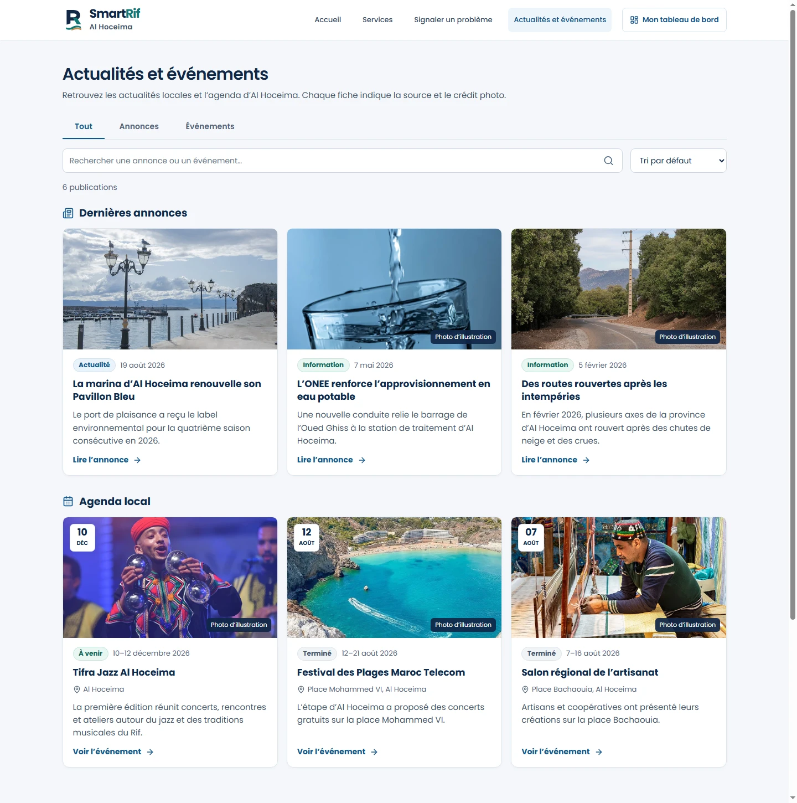
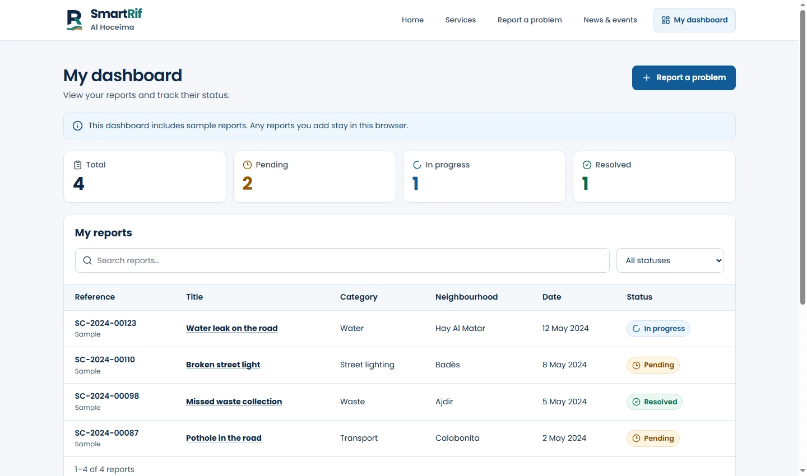

<p align="center">
  
</p>

<h1 align="center">SmartRif Al Hoceima</h1>

<p align="center">Portail citoyen de démonstration · Al Hoceima, Maroc</p>

<p align="center">
  
  
  
</p>

<p align="center">
  <strong><a href="http://localhost:5173/">Ouvrir l’aperçu local</a></strong> · <a href="#installation">Installation</a> · <a href="#aperçu">Captures d’écran</a>
</p>

Le portail réunit un annuaire de services, un parcours de signalement avec suivi et une sélection d’actualités et d’événements d’Al Hoceima. L’aperçu local s’ouvre après le lancement de `npm run dev`.

## Aperçu


<details>
<summary>Voir les pages Actualités et Tableau de bord</summary>

### Actualités et événements



### Tableau de bord citoyen



</details>

## Fonctionnalités

| Espace | Ce que vous pouvez faire |
| --- | --- |
| **Accueil** | Consulter la météo d’Al Hoceima, les indicateurs de démonstration, les dernières annonces et les événements à venir. |
| **Services** | Rechercher un service, filtrer par catégorie et ouvrir une fiche avec ses horaires et informations pratiques. |
| **Signalements** | Décrire un problème, joindre une photo facultative, vérifier le récapitulatif et obtenir une référence unique. |
| **Tableau de bord** | Rechercher et filtrer les signalements par statut, puis ouvrir leur fiche pour consulter l’historique des mises à jour. |
| **Actualités et événements** | Parcourir les publications locales, les filtrer par type et ouvrir leurs fiches avec les sources et les crédits photo. |
| **Administration démo** | Simuler la mise à jour d’un statut depuis la route `/administration-demo`. |

## Installation

**Prérequis** — Node.js 20.19 ou une version ultérieure de la branche 20, ou Node.js 22.12 et versions ultérieures. npm est fourni avec Node.js.

```bash
git clone https://github.com/ahmed200-em/Alhoceima-Smart-City.git
cd Alhoceima-Smart-City
npm ci
npm run dev
```

`npm ci` installe les versions enregistrées dans `package-lock.json`, y compris Tailwind CSS. Ouvrez l’adresse indiquée par Vite, généralement [http://localhost:5173](http://localhost:5173).

### Version de production

```bash
npm run build
npm run preview
```

Le build génère `dist/`. Un hébergement statique doit renvoyer les routes de l’application vers `index.html` pour permettre l’ouverture directe et l’actualisation d’une fiche.

## Tester le suivi d’un signalement

1. Ouvrez **Signaler un problème** et saisissez un exemple. Passez à l’étape de confirmation, puis soumettez le formulaire.
2. Notez la référence obtenue. Dans **Mon tableau de bord**, ouvrez la fiche et constatez le statut **En attente**.
3. Dans le même navigateur et sur le même site, ouvrez `/administration-demo`. Recherchez la référence, sélectionnez **En cours** et enregistrez.
4. Revenez à la fiche depuis le tableau de bord pour voir le nouveau statut et son horodatage. Répétez l’opération avec **Résolu** pour tester la fin du parcours.

Des exemples permettent aussi de consulter les trois statuts dès le premier lancement.

## Architecture

L’interface utilise **React 19** en JavaScript et JSX, **Vite 7** pour le développement et la compilation, **React Router 7** pour la navigation et **Tailwind CSS 4** pour la mise en page et les styles partagés. Les feuilles CSS propres à chaque interface sont placées à côté des fichiers JSX.

```text
src/
├── App.jsx          Routes et chargement des pages à la demande
├── components/      Marque, pied de page, météo et états de chargement
├── context/         Signalements et actions de mise à jour
├── data/            Services d’exemple, signalements et publications
├── hooks/           Requête météo et animations au défilement
├── layouts/         Navigation et cadre commun aux pages
├── pages/           Accueil, services, actualités, signalements et page 404
├── services/        Appel météo et accès au stockage du navigateur
├── utils/           Formatage et traitement des photos
└── styles.css      Thème Tailwind, styles de base et boutons partagés
public/             Logo et images du portail
docs/screenshots/   Captures présentées dans ce fichier
```

| Pour modifier… | Ouvrez… |
| --- | --- |
| La navigation | [`src/layouts/AppLayout.jsx`](src/layouts/AppLayout.jsx) et [`AppLayout.css`](src/layouts/AppLayout.css) |
| L’accueil | [`src/pages/Home.jsx`](src/pages/Home.jsx) et [`Home.css`](src/pages/Home.css) |
| Le pied de page | [`src/components/Footer.jsx`](src/components/Footer.jsx) et [`Footer.css`](src/components/Footer.css) |
| L’annuaire des services | [`src/data/services.js`](src/data/services.js) |
| Les actualités et les événements | [`src/data/news.js`](src/data/news.js) |

Les cartes d’attente, les animations au défilement et les transitions prennent en compte la préférence du système pour la réduction des animations.

## Sources et données

- **Météo.** L’accueil utilise Fetch API pour interroger Open-Meteo aux coordonnées d’Al Hoceima, dans le fuseau `Africa/Casablanca`. La requête sans clé expire après huit secondes. En cas d’échec, la carte permet de réessayer. [Documentation Open-Meteo](https://open-meteo.com/en/docs)
- **Actualités et événements.** La sélection est mise à jour manuellement dans le code. Chaque fiche indique sa source et les crédits de sa photo. Les dates des événements sont interprétées dans le fuseau d’Al Hoceima.
- **Services et indicateurs.** Les informations de l’annuaire et les chiffres de l’accueil sont fournis à titre de démonstration. L’illustration de la baie sur l’accueil a été générée pour le projet.

## Confidentialité et limites de la démo

Les signalements, photos jointes et historiques restent dans le navigateur, dans `localStorage` sous la clé `smartcity-al-hoceima-reports-v1`. Le site fonctionne sans compte partagé ni connexion à un système municipal.

Les photos JPG, PNG et WebP sont vérifiées et redimensionnées avant l’enregistrement, avec une limite de 10 Mo pour le fichier d’origine. Si le navigateur manque d’espace, le formulaire propose d’enregistrer sans photo. Effacer les données du site supprime les saisies locales et rétablit les exemples au prochain chargement.

L’administration démo est ouverte pour présenter le parcours. Utilisez des informations fictives lorsque vous testez le formulaire.
