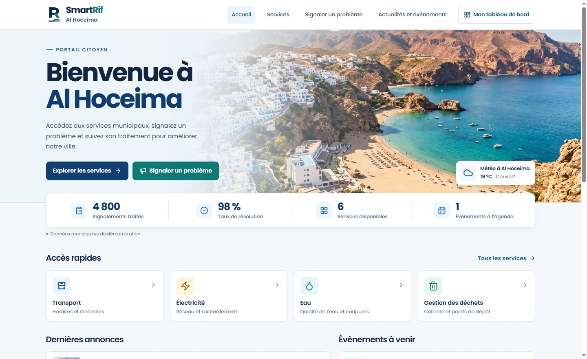

<p align="center">
  
</p>

<h1 align="center">SmartRif Al Hoceima</h1>

<p align="center">Citizen portal demo · Al Hoceima, Morocco</p>

<p align="center">
  
  
  
</p>

<p align="center">
  <strong><a href="https://alhoceima-smart-city.vercel.app/">Open the live site</a></strong> · <a href="http://localhost:5173/">Local preview</a> · <a href="#installation">Installation</a> · <a href="#preview">Screenshots</a> · <a href="#technologies">Technologies</a> · <a href="#author">Author</a>
</p>

SmartRif is an English-language portal for exploring municipal services, reporting and tracking local issues, and browsing news and events in Al Hoceima. Run `npm run dev` to open the local preview.

## Preview



<details>
<summary>See News &amp; events and the dashboard</summary>

### News & events


### Citizen dashboard


</details>

## Features

| Section | Path | What you can do |
| --- | --- | --- |
| **Home** | `/` | Check the weather in Al Hoceima, sample statistics, recent announcements and upcoming events. |
| **Services** | `/services` | Search and filter transport, electricity, water, waste management, street lighting and planning. Open a service to see example hours and practical details. |
| **Report a problem** | `/signaler` | Describe an issue, optionally attach a photo, review your details and receive a unique reference. |
| **My dashboard** | `/tableau-de-bord` | Search and filter reports by status. Open a report to see its timeline and updates. |
| **News & events** | `/actualites` | Search, sort and filter local posts. Open a post to see its source and photo credits. |
| **Demo administration** | `/administration-demo` | Simulate a change to a report’s status and see it reflected in the citizen dashboard. |

Reports have their own links under `/signalements/:id`. A recovery page links back to Home and Services when a route is missing.

## Technologies

| Technology | Role |
| --- | --- |
| **JavaScript and JSX** | Application logic and semantic HTML markup. |
| **React 19** | Reusable components, hooks and shared report state. |
| **Vite 7 and npm** | Local development, dependency installation and production builds. |
| **React Router 7** | Page navigation, detail URLs and filters in the query string. |
| **Tailwind CSS 4 and CSS** | Responsive layouts, theme tokens and component styles. |
| **Fetch API and Open-Meteo** | Weather requests, loading feedback and retry. |
| **`localStorage` and Web Locks** | Browser-only report persistence, with coordinated writes across tabs when supported. |
| **Lucide and Fontsource Poppins** | Interface icons and locally bundled typography. |

## Installation

Use Node.js 20.19 or later within the 20.x series, or Node.js 22.12 or later. npm is included with Node.js.

```bash
git clone https://github.com/ahmed200-em/Alhoceima-Smart-City.git
cd Alhoceima-Smart-City
npm ci
npm run dev
```

`npm ci` installs the versions recorded in `package-lock.json`, including Tailwind CSS. Open the address shown by Vite, usually [http://localhost:5173](http://localhost:5173).

### Production build

```bash
npm run build
npm run preview
```

The build writes to `dist/`. Configure static hosting to serve `index.html` for application routes so detail pages can be opened directly or refreshed.

## Test the report tracking workflow

1. Open **Report a problem** and enter a sample report. Review the details, then submit the form.
2. Keep the reference. Open the report from **My dashboard** to see its **Pending** status.
3. Open `/administration-demo` on the same site in the same browser. Find the reference, select **In progress** and save.
4. Return to the report from the dashboard to see the new status and its timestamp. Repeat the update with **Resolved** to complete the workflow.

Sample reports show all three statuses on first launch.

To check browsing, search for `water` in **Services** and open the result. In **News & events**, select **Events** and open a post to check its date, source and photo credit.

## Architecture

Component and page stylesheets sit alongside their JSX files. Layout and theme utilities live in `src/styles.css`.

```text
src/
├── App.jsx         Routes and lazy page loading
├── components/     Brand, footer, weather and loading states
├── context/        Reports and actions to update them
├── data/           Sample services, sample reports and local posts
├── hooks/          Weather request and scroll animations
├── layouts/        Navigation and shared page layout
├── pages/          Home, services, news, reports and the 404 page
├── services/       Weather API and browser storage
├── utils/          Formatting and photo processing
└── styles.css      Tailwind theme, base styles and shared buttons
public/             Portal logo and images
docs/screenshots/   Screenshots used in this README
```

| To change | Open |
| --- | --- |
| Navigation | [`src/layouts/AppLayout.jsx`](src/layouts/AppLayout.jsx) and [`AppLayout.css`](src/layouts/AppLayout.css) |
| Home | [`src/pages/Home.jsx`](src/pages/Home.jsx) and [`Home.css`](src/pages/Home.css) |
| Footer | [`src/components/Footer.jsx`](src/components/Footer.jsx) and [`Footer.css`](src/components/Footer.css) |
| Service directory | [`src/data/services.js`](src/data/services.js) |
| News & events | [`src/data/news.js`](src/data/news.js) |

The interface adapts to desktop, tablet and mobile. Navigation and forms support keyboard interaction and visible focus. Loading placeholders, scroll animations and transitions respect the system’s reduced motion preference.

## Sources and data

- **Weather.** The homepage uses the Fetch API to request weather for Al Hoceima from Open-Meteo using the city's coordinates and the `Africa/Casablanca` time zone. The request uses no API key and times out after eight seconds. If it fails, the weather card offers a retry. [Open-Meteo documentation](https://open-meteo.com/en/docs)
- **News and events.** The selection is maintained manually in the code. Each detail page lists its source and photo credit. Event dates use the Al Hoceima time zone.
- **Services and statistics.** Directory information and homepage figures are provided for demonstration. The homepage illustration of the bay was generated for the project.

## Privacy and demo limitations

Reports, attached photos and update history stay in the current browser in `localStorage` under the key `smartcity-al-hoceima-reports-v1`. The demo has no shared accounts or connection to a municipal system.

The app validates and resizes JPG, PNG and WebP photos before saving them. The original file may be up to 10 MB. If browser storage is full, the form offers to save the report without a photo. Clearing the site's data removes locally entered reports and restores the samples when the app next loads.

The demo administration page is openly accessible so you can try the tracking workflow. Use fictional details when testing the form.

## Author

SmartRif Al Hoceima was developed by [Ahmed Elmakrini (@ahmed200-em)](https://github.com/ahmed200-em).
